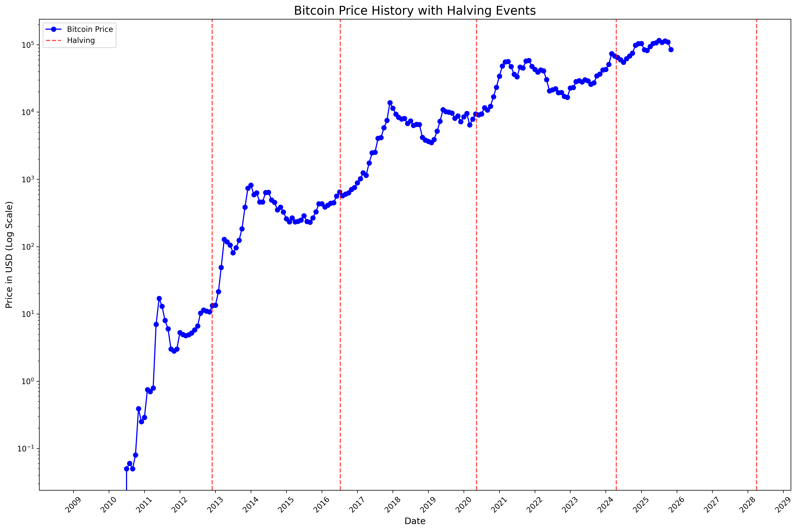
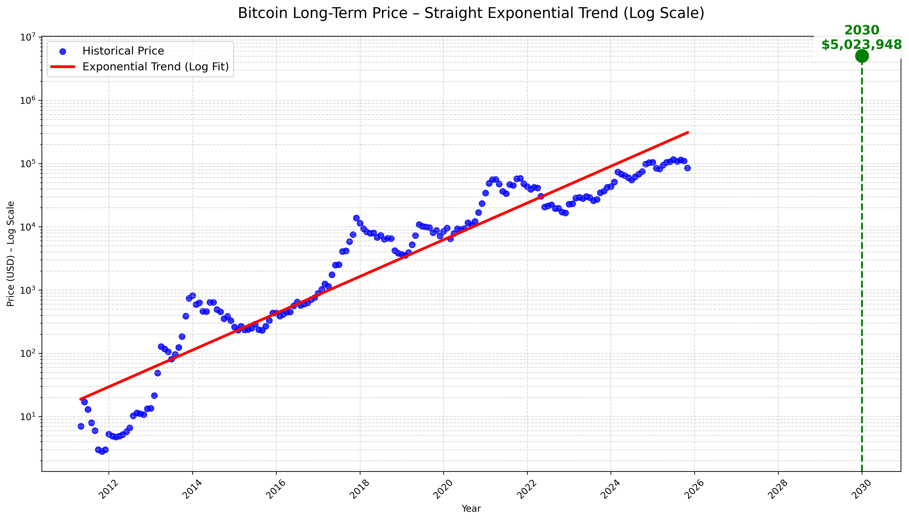

# Bitcoin Price Analysis – Halving Cycles & Power-Law Trend

Simple, clean Python scripts that visualize Bitcoin’s price history and long-term growth using real monthly data.

All charts are generated from a single CSV file: **`data/bitcoin-monthly-prices.csv`**

## Project Layout

```
data/      Input data
scripts/   Chart-generating scripts
charts/    Generated PNG output
```

## Generated Charts

### Bitcoin Halving Cycle Chart
Monthly price on log scale with every Bitcoin halving marked  


### Bitcoin Power-Law Trend (Log-Linear Regression)
Straight red line = true long-term exponential / power-law growth  
2030 prediction: **~$5–6 million** (depending on exact filtering)



## Scripts

| Script                        | What it does                                                                 |
|-------------------------------|-------------------------------------------------------------------------------|
| `scripts/halving-cycle-chart.py` | Plots price history (log scale) + vertical lines at each halving           |
| `scripts/power-law-trend.py`     | Fits log-linear regression → straight trend on log scale + 2030 extrapolation |

Both scripts resolve their input and output paths from the repository root, so they
can be run from any working directory.

## Quick Start

```bash
python -m venv .venv
source .venv/bin/activate
pip install pandas matplotlib scikit-learn

# Generate the charts (writes into charts/)
python scripts/halving-cycle-chart.py
python scripts/power-law-trend.py
```